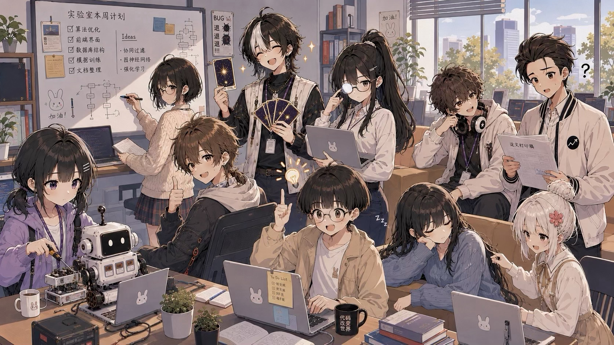

# Lab Life Simulator

A lightweight, narrative-driven academic lab management game.

You play as a newly appointed Principal Investigator (PI) and manage a research lab over six years. Random events, research projects, students, relationships, and unexpected academic chaos shape the story of your lab.

<p align="center">
  
</p>

## Gameplay

- **Monthly Events** — Encounter random events involving research, lab life, interpersonal situations, and unexpected incidents. Your choices affect both the story and the state of your lab.
- **Research Projects** — Unlock research ideas, start projects, and assign either the PI or students to lead them. Projects progress over time and provide rewards when completed.
- **Student Development** — Help students develop their skills and mindset through research projects and lab experiences, and watch them grow toward graduation.
- **Relationships** — Your interactions with students affect their affinity toward you and may unlock character-specific stories and CGs.
- **Endings & Achievements** — After six years, your lab's trajectory determines its ending. Special conditions unlock achievements that are recorded in the achievement gallery.

## Play Online

The recommended way to play is directly in your browser:

- https://lab-life-simulator.vercel.app/
- https://nataliazhang.github.io/lab-life-simulator/

## Run Locally

```bash
npm install
npm run dev
```

## Credits

Created with assistance from:

- **Claude Code** — programming and writing assistance
- **ChatGPT** — artwork and visual asset assistance

Third-party libraries, fonts, and other components remain subject to their respective licenses.

## Disclaimer

Lab Life Simulator is a fictional game created for entertainment purposes.

Characters, institutions, research projects, academic situations, and events depicted in the game are fictional or fictionalized. The game is not intended to represent or make factual claims about any particular individual, university, research institution, laboratory, or organization.

Lab Life Simulator is an independent personal project and is not affiliated with, sponsored by, or endorsed by any university, research institution, company, or other organization.

Some portions of the game were created with the assistance of generative AI tools, as described in the Credits section above.

## License

Lab Life Simulator is **source-available, but not open source under the OSI definition**.

You are welcome to:

- play the game for free;
- share links to the original game or repository;
- view and study the source code;
- use the source code for personal or educational learning;
- fork and modify the project for personal, educational, and other non-commercial experimentation.

However, **commercial use, commercial distribution, and monetization are not permitted without prior written permission from the copyright holder.**

The game's original characters, character designs, narrative content, dialogue, events, artwork, illustrations, CGs, game-specific settings, and other original creative assets remain reserved by the copyright holder. Their presence in this public repository does not place them in the public domain or grant unrestricted reuse rights.

If you are interested in using Lab Life Simulator or its original content commercially, a separate commercial license must be obtained from the copyright holder. Granting such a license does not transfer ownership of the underlying copyright unless explicitly agreed otherwise in writing.

Copyright © 2026 Natalia Zhang. All rights reserved.

See [`LICENSE`](./LICENSE) for the complete license terms.